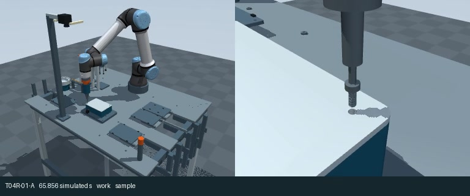
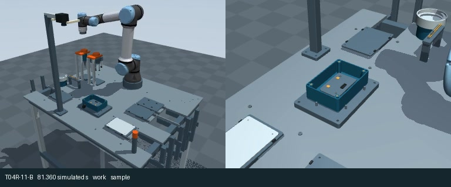
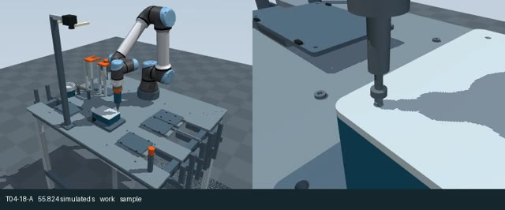
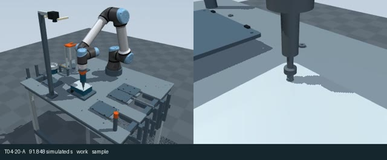

# Flexible Assembly Cell

Here is another interesting one for engineers! Could Codex (OpenAI’s standard coding agent) write assembly routines that a simulated robot arm could run on its own?

I gave Codex access to the low level commands and sensor readings and put it in a simulated assembly environment. I had it build two different automations using those commands and sensor readings. The point wasn’t for Codex to control the robot continuously but for the automations it builds to be able to run the assembly without it.

We ran 20 jobs across both automations Codex built. All passed except two on the same automation variant. Turns out Codex decided how much to push the driver down based on how much the driver itself turned. It then checked if the screw was in place. But the simulated physics allowed for slippage between the driver and the screw and Codex did not account for that. Codex had implemented a time limit for this routine. Because of the slippage in these two tests the time limit was reached before the screw placement was verified and it declared a fail.

I described the failure to Codex but I did not suggest a fix. It found that both automations allowed for the same failure. It then implemented a fix where it tracks the spinning and movement of the actual screw and adjusts the driver if slippage is detected. The fixed automations then passed 20/20 tests each.

I think this small experiment can give us some insight on how AI agents will impact manufacturing. Automated assembly lines can become at least a bit more flexible if an AI agent can build/change automations depending on what is being built. There’s still some work to do before this is common practice though especially when it comes to safety and reliability.

*The walkthrough and file guide below were written by dot, Randy Crespo’s AI assistant. Robot Codex wrote the assembly programs. Dev Codex prepared the simulator and ran the independent tests.*

## Watch the revised automation pass

### Variant A: full passing run (1:27)

The arm loads the housing, fits the lid, swaps tools, seats four screws, inspects the assembly, and delivers it.

https://github.com/user-attachments/assets/444dbbac-cb1a-4507-b584-68e3734d185e

### Variant B: full passing run (2:12)

The same arm adds a carrier before closing the housing. Watch it fasten and inspect the two layers at the same station.

https://github.com/user-attachments/assets/97be9ca1-180c-406a-9c25-bf2e51082d81

**Both revised programs passed 20 out of 20 fresh simulated jobs with no agent in the loop.** The test sequence was 10 A, 20 B, then 10 A again. One B attempt was interrupted before grading. The same setup passed on restart. The totals count one scored result per planned job.

## First, give Codex the cell

The experiment started with a simulated workcell, one arm, and two versions of a product. Randy wanted to see what Codex could do with the kinds of things an automation developer starts from. It had a station, interfaces for operating it, and a description of the finished job.

An early version of the experiment let Codex assemble a recipe from operations the station already offered. That left a more interesting question. **Could it write the operations needed to run the job?** In the second version the starter supplied the simulated station, specifications, and lower-level commands and observations. The assignment was to write the A and B assembly routines using those interfaces. The underlying arm control and physics were already in place.

We call the agent that authored the programs **Robot Codex** and the one that prepared and independently evaluated the test setup **Dev Codex**. The authoring session was asked to work from the starter and its own attempts. We don’t claim the session was provably blind. For the independent evaluation, Dev Codex verified the exact submitted programs and ran them against its own pinned simulator and grader. The simulator executed those trials unattended.

## Two screws told a better story than eighteen passes

The original programs passed 18 of 20 scored runs. A passed 8/10 and B passed 10/10. In two A runs, the simulated driver kept turning while the screw barely moved. The screw later resumed turning, but the routine ran out of time before the head seated. It was the first lid screw in one run and the last in the other.

### First lid screw failure (3.8 s)

https://github.com/user-attachments/assets/fa9453fd-4307-44be-822d-21a906ab65f8

### Last lid screw failure (3.8 s)

https://github.com/user-attachments/assets/c3186169-71dc-48b7-9be5-298705000a60

Watch the close-up on the right. About 1.4 seconds into each clip the screw makes little visible progress, then starts moving again. The last frame captures the stop. The [before-and-after tests](evidence/README.md#the-two-matched-setups) explain what was happening even when it’s hard to see in the clip.

Watching the bit spin looked like watching the screw go in, until it wasn’t. The original routine advanced the arm according to how far the driver turned. Those two things usually tracked each other. During slip, they didn’t. The test showed where that assumption broke. The underlying cause of every slowdown is still open.

## Tell the agent what failed

Randy described the failure to Robot Codex and left the diagnosis and repair to it. Robot Codex looked for the same behavior in B and found that it could happen there too, even though the B runs had passed. In both programs, it changed what the arm listens to. Instead of advancing with the driver’s turns, it watches how far the screw itself turns and descends. It also made its seating checks more specific. You can [read both submissions side by side](programs/README.md#open-the-submissions-side-by-side).

Dev Codex then tried the two exact A setups again, once with the original program and once with the revised one. **The old program failed both times. The revised program seated the screw and finished both jobs.** Those four runs were separate from the 40 fresh jobs.

| Exact setup | Original A | Revised A |
| --- | --- | --- |
| First lid screw | Reproduced the seating failure | Passed |
| Last lid screw | Reproduced the seating failure | Passed |

## What the tests show

An agent wrote and revised routines that a conventional automation runner could execute on its own. The interesting part is the handoff. The agent can leave, and the work keeps running. The independent tests also show why “it worked once” is a poor stopping point. They found a failure mode the initial successes hadn’t revealed, and the matching replays showed what the revision changed.

The results cover the simulated workcell and the tested setups. All trials ran in simulation. The files here document those trials.

## Explore the evidence

- [Original and revised assembly programs](programs/README.md)
- [How we checked the fix](evidence/README.md)
- [Third-party sources and notices](THIRD_PARTY_NOTICES.md)
- [License scope](LICENSE.md)

## Contact

**Randy Crespo, founder of [Dandelion Engineering](https://github.com/Dandelion-Engineering).**

- **LinkedIn:** [linkedin.com/in/randy-crespo](https://www.linkedin.com/in/randy-crespo)
- **Email:** [randy@dandelionengineering.com](mailto:randy@dandelionengineering.com)
